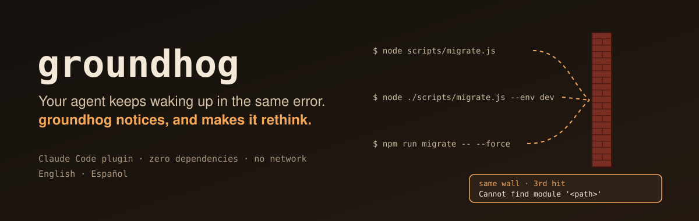

<div align="center">

[English](README.md) · **Español**



# groundhog

**Tu agente de código sigue despertando en el mismo error. groundhog se da cuenta.**

Un plugin para Claude Code que detecta cuándo el agente choca con el mismo muro usando comandos *distintos*, o reescribe una y otra vez sus propias ediciones, y le pide parar y pensar antes del siguiente intento.

[](https://github.com/Shiroe-95/groundhog/actions/workflows/ci.yml)
[](LICENSE)


[El problema](#el-problema) · [Qué ganas](#qué-ganas) · [Cómo se compara](#cómo-se-compara) · [Cómo funciona](#cómo-funciona) · [Instalación](#instalación) · [Evidencia](#evidencia) · [Investigación](#investigación-que-lo-respalda) · [Privacidad](#privacidad-y-seguridad)

</div>

---

## El problema

Seguro lo has visto. El agente corre los tests, recibe un error, ajusta el comando, recibe el mismo error, prueba otro flag, luego otro archivo, luego otra herramienta. Seis intentos después nada ha cambiado, y la ventana de contexto está llena de fallos casi idénticos.

**Sin groundhog:**

```
> npm test                 Error: Cannot find module '/app/src/db.js'
> npx jest                 Error: Cannot find module '/app/src/db.js'
> node test/run.js         Error: Cannot find module '/app/src/db.js'
> npm test -- --runInBand  Error: Cannot find module '/app/src/db.js'
> ...                      (el agente sigue adivinando; tú sigues pagando)
```

**Con groundhog**, en el segundo fallo el agente sabe que es el mismo muro, ve lo que ya intentó y se le pide una hipótesis comprobable. En el tercero se le pide dejar de adivinar y elegir: encontrar la causa raíz, pasarle el problema a un subagente nuevo con un resumen corto, o preguntarte a ti.

La mayoría de los detectores de bucles buscan llamadas **idénticas**: misma herramienta, mismos argumentos, una y otra vez. Eso atrapa el bucle más tonto, pero no el más común. El agente casi nunca se repite exactamente. Cambia la entrada cada vez, y el error sigue igual.

Lo medí en mi propio historial de Claude Code con `/groundhog-report`:

| Qué | Cantidad |
| --- | --- |
| Sesiones analizadas | 620 |
| Sesiones que chocaron con al menos un muro | 114 (18%) |
| Muros (misma herramienta, mismo error, 3+ veces en una sesión) | 140 |
| Llamadas fallidas gastadas dentro de esos muros | 632 |
| Muros donde el agente **cambió la entrada al menos una vez** | 108 (77%) |
| Muros hechos solo de reintentos idénticos | 32 (23%) |
| Ediciones que deshicieron una edición anterior (A a B, de vuelta a A) | 14 |

En tres de cada cuatro muros el agente cambió el comando por el camino, así que un detector que espera N llamadas idénticas seguidas ve un bucle más corto, o ninguno. groundhog cuenta el error, así que los cambios no esconden el muro.

Puedes sacar la misma tabla de tus propias sesiones con `/groundhog-report`.

## Qué ganas

| Beneficio | Qué significa para ti | De dónde sale el dato |
| --- | --- | --- |
| **Menos reintentos perdidos** | El agente se entera de que está en bucle en el 2.º fallo, no en el 6.º. En mi historial, el 16% de todas las llamadas fallidas llegó después de ese punto. Ese es el techo de lo que la nota puede ahorrar. | [Evidencia](#evidencia) |
| **Una ventana de contexto más limpia** | Cada fallo repetido vuelve a pegar el mismo error en la conversación. Cortar el bucle antes deja más espacio para el trabajo que importa. | [Evidencia](#evidencia) |
| **Te enteras antes de los bloqueos** | En el 3.er choque se le pide al agente encontrar la causa raíz, pasar el problema con un resumen corto o preguntarte, en vez de seguir adivinando en silencio mientras esperas. | [Lo que ve el agente](#lo-que-ve-el-agente) |
| **Se acaba el ping-pong de ediciones** | Detecta cuando una edición deshace otra anterior, o cuando el agente reescribe las mismas líneas después de cada fallo. | [Cómo funciona](#cómo-funciona) |
| **No cuesta nada cuando todo va bien** | No hay nota salvo que algo de verdad se repita: más o menos una por cada 100 llamadas. Nunca bloquea una herramienta, no hace llamadas de red y no tiene dependencias. | [Evidencia](#evidencia), [Privacidad](#privacidad-y-seguridad) |
| **Funciona con lo que ya usas** | Cubre también las herramientas MCP, cede el paso a tu propia skill de depuración si la tienes y convive con otros hooks. | [Convive con tu configuración](#convive-con-tu-configuración) |
| **Un espejo de tus propias sesiones** | `/groundhog-report` te dice cada cuánto se atasca tu agente y dónde, antes de instalar nada. | [Uso](#uso) |

## Cómo se compara

Hoy hay cuatro formas comunes de lidiar con un agente atascado. Cada una resuelve una parte del problema:

| Enfoque | Detecta un bucle donde el comando va cambiando | Detecta el ping-pong de ediciones | Nunca bloquea una herramienta | Avisa solo, en el momento justo |
| --- | --- | --- | --- | --- |
| No hacer nada, dejar que el agente reintente | No | No | Sí | No |
| Detectores de llamadas idénticas (LoopGuard, loop-circuit-breaker, agent-loop-detector) | Solo cuando la llamada se repite exacta | No: una edición y su reversión son llamadas distintas | Depende de la herramienta | Sí |
| Bloquear la herramienta tras N fallos | Solo si cuenta fallos y no llamadas | No | No | Sí, frenando al agente |
| Reglas de depuración en `CLAUDE.md` o una skill de depuración | Solo si el agente se da cuenta de que está en bucle | No | Sí | No: el agente tiene que acordarse |
| **groundhog** | **Sí: cuenta el error, no el comando** | **Sí: reversiones y retrabajo** | **Sí** | **Sí: en el 2.º y 3.er choque** |

Por qué importa: en mi historial, en el 77% de los muros el comando cambió al menos una vez, así que la primera y la tercera fila ven un bucle más corto o ninguno. groundhog no reemplaza a los demás. Funciona junto a un detector de llamadas idénticas, y si tienes una skill de depuración le dice al agente que la use justo cuando hace falta. Más detalle en [¿Por qué no simplemente...](#por-qué-no-simplemente).

## Cómo funciona

groundhog son dos hooks pequeños y dos skills. Sin red, sin dependencias, sin procesos en segundo plano.

```
falla una herramienta ──> hook PostToolUseFailure  (cualquiera, incluidas las de MCP)
                 │
                 ├─ normaliza el error en una firma
                 │    rutas -> <path>   hashes -> <hex>   números -> <n>
                 │
                 ├─ ¿misma herramienta y firma igual (o casi igual)? cuéntalo
                 ├─ ¿pasan más tests que la vez anterior? hay progreso: reinicia
                 │
                 ├─ 2.º choque: hipótesis, predicción, comprobación
                 └─ 3.º choque: para. causa raíz, subagente nuevo o preguntar

Edit sale bien ──> hook PostToolUse
                 ├─ ¿esta edición revierte una anterior? lo dice
                 └─ ¿reescribe otra vez sus propias líneas tras un fallo? lo dice
```

**La firma es la idea clave.** `Cannot find module '/home/a/src/db.js'` y `Cannot find module 'C:\work\src\db.js'` son el mismo muro. Los números de línea, las rutas temporales, los hashes de commit y los puertos cambian en cada intento. La causa no. groundhog quita el ruido y se queda con la forma del error. Dos errores largos de la misma herramienta que difieren en una sola palabra (el nombre de un workspace, por ejemplo) también cuentan como un solo muro.

Cuando el contador cruza un umbral, el hook agrega una nota corta junto al resultado de la herramienta. El agente la ve en su siguiente turno. groundhog nunca bloquea una llamada ni reescribe la salida. Solo agrega evidencia.

### Lo que ve el agente

Esta es la salida real del hook, copiada de una ejecución. Los mensajes están en inglés porque van dirigidos al agente.

En el segundo choque:

```
groundhog: this is the 2nd time this session that Bash failed with the same error signature:
  "Error: Cannot find module '<path>'"
Recent attempts:
  1. npm test
  2. npx jest
The input changed but the error did not, so the cause is probably not what the last attempt changed. Before the next retry:
  1. Write one sentence with a new hypothesis that explains every failure above.
  2. Pick the cheapest check that could prove it wrong, and predict what it will print.
  3. Run it and quote the line of output that confirms or kills the hypothesis.
If you have your own debugging skill or process, use it for these steps.
```

En el tercero:

```
groundhog: this is the 3rd time this session that Bash failed with the same error signature:
  "Error: Cannot find module '<path>'"
Recent attempts:
  1. npm test
  2. npx jest
  3. node test/run.js
Stop retrying variations: this is a wall, not bad luck. Pick one:
  a) Read the full error and the exact code or config it points at, then state the root cause.
  b) Hand the problem to a fresh-context subagent.
  c) Ask the user.
For b) and c), send a brief, not logs: the goal, the facts you verified (with the command that verified each), the hypotheses you ruled out, and the signature above.
If you have your own debugging skill or process, use it now; otherwise the groundhog:unstick skill has the full protocol.
```

Cuando una edición revierte una edición anterior del mismo archivo (cortado aquí para leerlo; la nota real es una sola línea):

```
groundhog: this edit undoes an earlier edit to config.ts in this session
(back-and-forth #1). You are oscillating between two versions. Before touching
this file again, decide which version is correct and cite the evidence (test output,
docs, the caller that needs it).
```

Cuando el agente entra en el ciclo editar, fallar, volver a editar las mismas líneas (también cortado):

```
groundhog: you have rewritten lines you wrote earlier in parser.js 3 times this session.
Editing the same spot again and again usually means each change is a guess. Before the
next edit to this file, run the check that shows whether the last change worked, and
say what it printed.
```

## Instalación

Dentro de Claude Code:

```
/plugin marketplace add Shiroe-95/groundhog
/plugin install groundhog@groundhog
```

O desde una terminal:

```bash
claude plugin marketplace add Shiroe-95/groundhog
claude plugin install groundhog@groundhog
```

Necesitas Node.js 20.1 o superior en tu `PATH`. Quien usa Claude Code casi siempre ya lo tiene.

## Uso

Una vez instalado, no hay nada que ejecutar. Los hooks trabajan solos.

| Comando | Qué hace |
| --- | --- |
| `/groundhog-report` | Analiza tu historial local de sesiones y muestra tus muros principales, cuántos tuvieron entradas cambiantes y cuántas ediciones se revirtieron. |
| skill `groundhog:unstick` | El protocolo que sigue el agente cuando aparece una nota. El agente la carga solo. También puedes llamarla por nombre. |

También puedes correr el reporte fuera de Claude Code:

```bash
node scripts/report.js            # inglés
node scripts/report.js --lang es  # español
node scripts/report.js --json     # números en bruto
node scripts/report.js --dir /ruta/a/transcripts
```

## Convive con tu configuración

groundhog está pensado para ir debajo de lo que ya usas, no para reemplazarlo.

- **Tus skills van primero.** Cada nota dice: *"If you have your own debugging skill or process, use it."* Si tienes una skill de depuración, un flujo con tests primero o un protocolo propio, el agente vuelve a él. `groundhog:unstick` es solo el respaldo.
- **Cubre las herramientas MCP.** El hook de fallos aplica a toda herramienta, así que una base de datos, un navegador o un servidor de API que falla siempre igual se cuenta igual que `Bash` (hay un test para `mcp__db__query`).
- **Nunca bloquea.** No niega llamadas, no reescribe salidas ni detiene la sesión. Solo agrega unas líneas de contexto, así que no puede romper los hooks de otro plugin ni los tuyos.
- **Convive con otros hooks.** Claude Code ejecuta todos los hooks que coinciden. Los de groundhog tardan milisegundos, solo escriben en su propia carpeta de datos y se quedan callados ante lo que no entienden.
- **Un interruptor para apagarlo:** `GROUNDHOG_DISABLE=1`.

## Configuración

Todos los ajustes son variables de entorno. Defínelas en tu shell o en el bloque `env` de la configuración de Claude Code.

| Variable | Valor por defecto | Significado |
| --- | --- | --- |
| `GROUNDHOG_WARN_AT` | `2` | Número de choque que dispara la primera nota (de 2 a 20). |
| `GROUNDHOG_STOP_AT` | `3` | Número de choque que dispara la nota de "para" (nunca menor que `WARN_AT`). |
| `GROUNDHOG_DISABLE` | sin definir | Ponla en `1` para apagar groundhog sin desinstalarlo. |

## Evidencia

Las afirmaciones salen baratas, así que aquí está lo que puedes comprobar tú mismo.

**Funciona como se describe.** 56 tests automáticos con el runner integrado de Node, en Linux, macOS y Windows con Node 20, 22 y 24 en CI. Cubren el 2.º y 3.º choque, errores casi iguales que deben unirse y errores cortos que no, el reinicio por progreso, reversiones, retrabajo, herramientas MCP, entradas malformadas y gigantes, path traversal en ids de sesión, archivos de estado corruptos y el enmascarado de secretos. Los mensajes de arriba están pegados de una ejecución real, no escritos a mano.

```bash
node --test
claude plugin validate . --strict
```

**Lo que habría atrapado.** `bench/replay.js` vuelve a pasar tus sesiones guardadas por el mismo detector y cuenta lo que pasó *después* del momento en que groundhog habría hablado. En mis 620 sesiones:

| Qué | Valor |
| --- | --- |
| Llamadas a herramientas reproducidas | 78.443 |
| Llamadas fallidas | 2.203 (2,8%) |
| Notas que groundhog habría agregado | 863 (1,1 por cada 100 llamadas) |
| Sesiones que recibirían al menos una nota | 266 (43%) |
| Llamadas fallidas **después** de la primera nota de su muro | 352 (16% de todos los fallos) |
| Llamadas fallidas **después** de la nota de "para" | 212 (9,6% de todos los fallos) |
| Salida de error en esas 352 llamadas | unos 28 mil tokens |

Léelo como un techo, no como un experimento A/B. Muestra cuánto trabajo fallido ocurrió después del punto donde groundhog habla, que es lo máximo que una nota podría ahorrar. No prueba que el agente habría hecho caso. La tasa de notas es el costo: más o menos una nota corta por cada cien llamadas. Aun así, cuatro de cada diez sesiones verían al menos una, por eso las notas son cortas y solo aparecen cuando algo de verdad se repite.

Córrelo sobre tu propio historial (solo imprime agregados, nunca comandos ni nombres de archivo):

```bash
node bench/replay.js           # ~/.claude/projects
node bench/replay.js --json
node bench/replay.js --dir /ruta/a/transcripts
```

## Investigación que lo respalda

Cada decisión de diseño se apoya en trabajo publicado. groundhog no reproduce los experimentos de estos papers; aplica sus hallazgos a un problema concreto.

| Decisión de diseño | Qué dice la investigación | Fuente |
| --- | --- | --- |
| Hablar pronto: 2.º choque, parar en el 3.º | La efectividad de la depuración cae rápido con cada intento repetido; un reinicio estratégico ayuda | Adnan & Kuhn 2025, [The Debugging Decay Index](https://arxiv.org/abs/2506.18403) |
| Pasar a un contexto nuevo en vez de seguir | Los modelos que toman un mal giro en una conversación larga casi nunca se recuperan; empezar limpio con los hechos consolidados funciona mejor | Laban et al. 2025, [LLMs Get Lost In Multi-Turn Conversation](https://arxiv.org/abs/2505.06120) |
| | Los modelos se condicionan con sus propios errores anteriores y cometen más en tareas largas | Sinha et al. 2025, [The Illusion of Diminishing Returns](https://arxiv.org/abs/2509.09677) |
| "Manda un resumen, no logs" | Descartar la salida vieja de las herramientas funciona tan bien como resumirla, y cuesta menos | Lindenbauer et al. 2025, [The Complexity Trap](https://arxiv.org/abs/2508.21433) |
| Nota corta pegada al fallo | La información enterrada en medio de un contexto largo suele ignorarse | Liu et al. 2023, [Lost in the Middle](https://arxiv.org/abs/2307.03172) |
| La hipótesis se prueba ejecutando algo | La autocorrección sin retroalimentación externa no ayuda, y puede empeorar | Huang et al. 2023, [LLMs Cannot Self-Correct Reasoning Yet](https://arxiv.org/abs/2310.01798) |
| | La autocorrección funciona cuando hay retroalimentación externa confiable | Kamoi et al. 2024, [When Can LLMs Actually Correct Their Own Mistakes?](https://arxiv.org/abs/2406.01297) |
| | La autorreparación gana poco cuando se cuenta su costo; lo que ayuda es mejor retroalimentación | Olausson et al. 2023, [Is Self-Repair a Silver Bullet for Code Generation?](https://arxiv.org/abs/2306.09896) |
| Hipótesis, predicción, comprobación, citar el resultado | Un ciclo de depuración científica (hipótesis, predicción, experimento, conclusión) iguala a los métodos de reparación de referencia y además produce explicaciones que ayudaron a los desarrolladores a juzgar los parches | Kang et al. 2023, [Explainable Automated Debugging via LLM-driven Scientific Debugging](https://arxiv.org/abs/2304.02195) |
| | Explicar el código contra resultados reales de ejecución ayuda a los modelos a arreglar sus propios bugs | Chen et al. 2023, [Teaching LLMs to Self-Debug](https://arxiv.org/abs/2304.05128) |
| | Una reflexión verbal corta sobre un fallo mejora el siguiente intento | Shinn et al. 2023, [Reflexion](https://arxiv.org/abs/2303.11366) |
| Errores casi iguales cuentan como un muro | En un estudio sobre una aplicación de agentes, combinar similitud estructural y semántica encontró más ciclos que cada una por separado | George et al. 2025, [Unsupervised Cycle Detection in Agentic Applications](https://arxiv.org/abs/2511.10650) |
| Pista para la herramienta Edit y detector de retrabajo | La interfaz agente-computadora moldea a los agentes de código; las ediciones fallidas tienden a encadenar más ediciones fallidas | Yang et al. 2024, [SWE-agent](https://arxiv.org/abs/2405.15793) |
| Tratar la repetición como modo de fallo | Repetir pasos y no saber cuándo parar son modos de fallo recurrentes en sistemas de agentes | Cemri et al. 2025, [Why Do Multi-Agent LLM Systems Fail?](https://arxiv.org/abs/2503.13657) |

## Privacidad y seguridad

groundhog se construyó para poder instalarse sin riesgo en una máquina de trabajo.

**Qué ejecuta:** dos scripts de Node.js, solo cuando una herramienta falla o un `Edit` sale bien. Cada uno lee el payload del hook por stdin, actualiza un archivo JSON pequeño y termina. Nada queda corriendo.

**Qué guarda:** un archivo JSON por sesión en la carpeta de datos que da Claude Code (o en una carpeta propia de tu usuario dentro de la carpeta temporal del sistema), legible solo por ti, borrado a los 7 días. Contiene:

- por cada muro: la firma normalizada del error (rutas, números, URLs, correos y tokens enmascarados; aun así puede contener palabras como el nombre de una tabla o un módulo), un contador, el mayor "N passed" visto, hashes de las dos últimas entradas y los últimos 5 comandos, cortados a 100 caracteres, con URLs, correos, tokens y secretos `clave=valor` enmascarados;
- para hasta 100 archivos editados: un hash de la ruta, hashes SHA-256 truncados del texto editado y de las líneas editadas (nunca el texto) y contadores de reversiones y retrabajo;
- un contador de fallos de la sesión.

**Qué envía:** nada. No hay llamadas de red. Compruébalo con `grep -r "http" scripts/`.

Además:

- **Sin dependencias.** Solo la biblioteca estándar de Node.js. No hay cadena de suministro que comprometer.
- **Salida depurada.** Las firmas reemplazan rutas, URLs, correos, tokens, hashes y números por marcadores. El reporte va más allá: nunca imprime comandos y enmascara nombres entre comillas, identificadores CamelCase y nombres de servidores MCP. El enmascarado se basa en patrones, así que dale una mirada rápida antes de publicar un reporte.
- **Ante la duda, silencio.** Una entrada malformada, un archivo de estado corrupto o un payload gigante hacen que el hook salga sin decir nada. Nunca rompe tu sesión.
- **Reporte y bench de solo lectura.** Solo leen transcripts. No escriben nada.

¿Encontraste un problema de seguridad? Mira [SECURITY.md](SECURITY.md).

## ¿Por qué no simplemente...

**...usar un detector de llamadas idénticas?** Herramientas como LoopGuard, loop-circuit-breaker y agent-loop-detector hacen bien lo suyo. Pero toman la huella de la *llamada*, y en mis datos la mayoría de los muros cambian la llamada cada vez. groundhog toma la huella del *error*. Los dos enfoques funcionan bien juntos.

**...bloquear la herramienta tras N fallos?** Bloquear estorba cuando el reintento es deliberado, como consultar un servidor que todavía está arrancando. Una nota deja la decisión al agente y te mantiene a ti al mando.

**...usar un hook Stop?** Los hooks Stop de plugins tienen asperezas ([anthropics/claude-code#10412](https://github.com/anthropics/claude-code/issues/10412)). Comentar el fallo justo donde ocurre es más simple y funciona hoy.

Discusiones relacionadas: [#4317](https://github.com/anthropics/claude-code/issues/4317) (detección de bucles), [#12768](https://github.com/anthropics/claude-code/issues/12768) (detección de thrashing), [#47033](https://github.com/anthropics/claude-code/issues/47033) (seguimiento de fallos por sesión), [#42796](https://github.com/anthropics/claude-code/issues/42796) (tasa de bucles).

## Limitaciones

- La firma es una heurística. Dos bugs distintos pueden compartir una línea de error ("Segmentation fault"), y un mismo bug puede imprimir dos líneas distintas. La unión de errores casi iguales junta errores de la misma herramienta cuyos conjuntos de palabras distintas coinciden en un 80% o más. En la práctica una sola palabra distinta solo se absorbe cuando el error tiene 9 o más palabras distintas, así que los errores cortos quedan separados, pero dos errores largos que solo difieren en el nombre de un tipo pueden unirse. Los umbrales son bajos a propósito para que una falsa alarma cueste una sola frase.
- El reinicio por progreso solo entiende runners de tests que imprimen "N passed".
- Solo se revisan las llamadas `Edit` para reversiones y retrabajo. Los cambios hechos con `Write` o con un comando de shell no se ven.
- Los contadores son por sesión. Un muro que abarca varias sesiones se ve en el reporte, no en vivo.
- El reporte y el bench leen el formato de transcript que usa Claude Code hoy. Si ese formato cambia, podrían contar de menos hasta que se actualicen. Los hooks no dependen de él.

## Preguntas frecuentes

**¿Gasta tokens?** Unos cientos por nota. En la reproducción de arriba fue más o menos una nota por cada cien llamadas.

**¿Me va a molestar en el trabajo normal?** Solo cuando la misma herramienta falla con el mismo error dos veces en una sesión, una edición deshace otra anterior, o aparece un ciclo de ediciones después de un fallo. Las sesiones sin nada de eso nunca lo oyen.

**¿Funciona con subagentes?** Sí. Los hooks también se disparan en las llamadas de los subagentes, y se cuentan en la sesión que las reporta.

**¿Windows?** Sí. El CI corre en Linux, macOS y Windows.

## Desarrollo

```bash
git clone https://github.com/Shiroe-95/groundhog
cd groundhog
node --test
claude plugin validate . --strict
```

Para probar tu copia local en Claude Code: `claude --plugin-dir .`

Los detalles están en [CONTRIBUTING.es.md](CONTRIBUTING.es.md).

## Autor

Hecho por **Wilson Vargas Martinez**, ingeniero. [LinkedIn](https://www.linkedin.com/in/wilsonvm09) · [GitHub](https://github.com/Shiroe-95)

## Licencia

[MIT](LICENSE). Úsalo, haz fork, publícalo.
