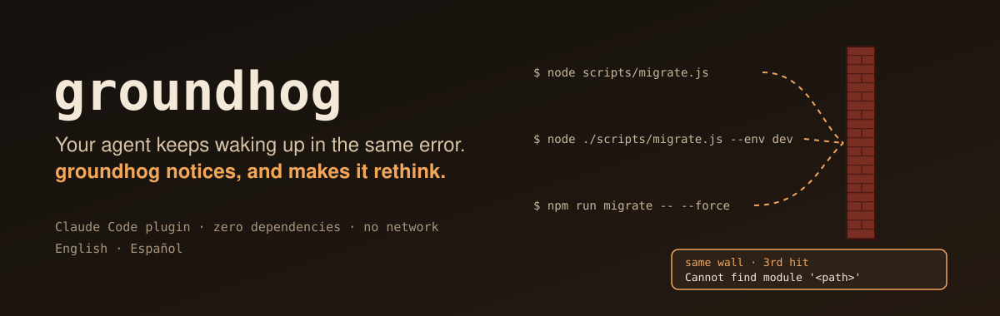

<div align="center">

**English** · [Español](README.es.md)



# groundhog

**Your coding agent keeps waking up in the same error. groundhog notices.**

A Claude Code plugin that spots when the agent hits the same wall through *different* commands, or keeps rewriting its own edits, and tells it to stop and think before the next try.

[](https://github.com/Shiroe-95/groundhog/actions/workflows/ci.yml)
[](LICENSE)


[In 30 seconds](#in-30-seconds) · [The problem](#the-problem) · [What you get](#what-you-get) · [How it compares](#how-it-compares) · [How it works](#how-it-works) · [Install](#install) · [Evidence](#evidence) · [Research](#research-behind-it) · [Privacy](#privacy-and-security)

</div>

---

## In 30 seconds

New to all this? Start here.

- **Claude Code** is an AI assistant that works inside your project. It reads files, edits code and runs commands (tests, builds, scripts) on its own. People call this kind of assistant a *coding agent*.
- **The problem:** sometimes the agent gets stuck. A command fails, it tries a slightly different command, it fails with the very same error, and it keeps going like that. Each try costs time and money, and fills its memory with the same error again and again. The agent does not always realize it is going in circles.
- **What groundhog does:** it watches for that pattern. When the same error comes back, it adds a short note for the agent: *"this is the same problem as before, here is what you already tried, stop and test a real idea."* If it happens a third time, the note says: *"stop guessing: find the cause, hand it to a fresh helper, or ask the user."*
- **What you do:** install it once. There is nothing to run and nothing to configure. It stays quiet until the agent repeats a failure.
- **What it never does:** it does not block the agent, change your code, or send anything over the internet. It only adds a few lines of advice at the right moment.

Think of a colleague looking over the agent's shoulder who says *"you already tried that, it's the same error"* before the sixth attempt instead of after it.

The name comes from the film *Groundhog Day*, where the main character wakes up to the same day over and over until he changes his approach. A stuck agent lives the same error over and over. groundhog points that out.

**Who it is for:** anyone who lets Claude Code run commands on its own: developers, teams that use it in long sessions, and people who are not experts and cannot always tell when the agent is spinning its wheels.

## The problem

You have seen it. The agent runs the tests, gets an error, tweaks the command, gets the same error, tries a different flag, then a different file, then a different tool. Six attempts later nothing has moved, and the context window is full of near-identical failures.

**Without groundhog:**

```
> npm test                 Error: Cannot find module '/app/src/db.js'
> npx jest                 Error: Cannot find module '/app/src/db.js'
> node test/run.js         Error: Cannot find module '/app/src/db.js'
> npm test -- --runInBand  Error: Cannot find module '/app/src/db.js'
> ...                      (the agent keeps guessing; you keep paying)
```

**With groundhog**, on the second failure the agent is told that this is the same wall, shown what it already tried, and asked for a testable hypothesis. On the third it is told to stop guessing and either find the root cause, hand off to a fresh subagent with a short brief, or ask you.

Most loop guards look for **identical** calls: same tool, same arguments, over and over. That catches the dumbest loop, but it is not the common one. The agent rarely repeats itself exactly. It changes the input every time, and the error stays the same.

Measured with `/groundhog-report` on a sample of 620 real Claude Code sessions:

| What | Count |
| --- | --- |
| Sessions scanned | 620 |
| Sessions that hit at least one wall | 114 (18%) |
| Walls (same tool, same error, 3+ times in one session) | 140 |
| Failed calls spent inside those walls | 632 |
| Walls where the agent **changed the input at least once** | 108 (77%) |
| Walls made only of identical retries | 32 (23%) |
| Edits that undid an earlier edit (A to B, back to A) | 14 |

In three out of four walls the agent changed the command along the way, so a detector that waits for N identical calls in a row sees a shorter loop, or none at all. groundhog counts the error instead, so the changes do not hide the wall.

You can get the same table for your own sessions with `/groundhog-report`.

## What you get

| Benefit | What it means for you | Where the number comes from |
| --- | --- | --- |
| **Fewer wasted retries** | The agent is told it is looping on the 2nd failure, not the 6th. In the sample, 16% of all failed calls came after that point. That is the ceiling on what the note can save. | [Evidence](#evidence) |
| **A cleaner context window** | Every repeated failure pastes the same error into the conversation again. Stopping the loop earlier leaves more room for the work that matters. | [Evidence](#evidence) |
| **You hear about blockers sooner** | On the 3rd hit the agent is asked to find the root cause, hand off with a short brief, or ask you, instead of guessing quietly while you wait. | [What the agent sees](#what-the-agent-sees) |
| **No more edit ping-pong** | It notices when an edit undoes an earlier one, or when the agent keeps rewriting the same lines after each failure. | [How it works](#how-it-works) |
| **Nothing to pay when things go well** | No note unless something actually repeats: about one per 100 tool calls. It never blocks a tool, makes no network calls and has no dependencies. | [Evidence](#evidence), [Privacy](#privacy-and-security) |
| **Works with what you already use** | Covers MCP tools too, defers to your own debugging skill if you have one, and runs next to other hooks. | [Plays well with your setup](#plays-well-with-your-setup) |
| **A mirror of your own sessions** | `/groundhog-report` tells you how often your agent gets stuck and where, before you install anything. | [Usage](#usage) |

## How it compares

There are four common ways to deal with a stuck agent today. Each one solves part of the problem:

| Approach | Catches a loop where the command keeps changing | Catches edit ping-pong | Never blocks a tool | Speaks up on its own, at the right moment |
| --- | --- | --- | --- | --- |
| Do nothing, let the agent retry | No | No | Yes | No |
| Identical-call loop detectors (LoopGuard, loop-circuit-breaker, agent-loop-detector) | Only once the call repeats exactly | No: an edit and its undo are different calls | Depends on the tool | Yes |
| Block the tool after N failures | Only if it counts failures, not calls | No | No | Yes, by stopping the agent |
| Debugging rules in `CLAUDE.md` or a debugging skill | Only if the agent notices it is looping | No | Yes | No: the agent has to remember them |
| **groundhog** | **Yes: it counts the error, not the command** | **Yes: reverts and rework** | **Yes** | **Yes: on the 2nd and 3rd hit** |

Why that matters: in the sample, 77% of walls had the command changed at least once, so the first and third rows see a shorter loop or none at all. groundhog does not replace the others. It works next to an identical-call detector, and when you have a debugging skill it tells the agent to use it at the moment it is needed. More detail in [Why not just...](#why-not-just).

## How it works

groundhog is two small hooks and two skills. No network, no dependencies, no background process.

```
tool fails ──> PostToolUseFailure hook  (any tool, MCP tools included)
                 │
                 ├─ normalize the error into a signature
                 │    paths -> <path>   hashes -> <hex>   numbers -> <n>
                 │
                 ├─ same tool + same (or nearly the same) signature? count it
                 ├─ more tests passing than last time? progress: reset the count
                 │
                 ├─ 2nd hit: hypothesis, prediction, check
                 └─ 3rd hit: stop. root cause, fresh subagent, or ask the user

Edit succeeds ──> PostToolUse hook
                 ├─ this edit reverses an earlier one? say so
                 └─ rewriting its own lines again after a failure? say so
```

**The signature is the key idea.** `Cannot find module '/home/a/src/db.js'` and `Cannot find module 'C:\work\src\db.js'` are the same wall. Line numbers, temp paths, commit hashes and ports change on every attempt. The cause does not. groundhog strips the noise and keeps the shape of the error. Two long errors from the same tool that differ in a single word (a workspace name, say) are also treated as one wall.

When the count crosses a threshold, the hook adds a short note next to the tool result. The agent sees it on its next turn. groundhog never blocks a call and never rewrites output. It only adds evidence.

### Inside the failure hook, step by step

Claude Code runs the hook after every tool call that fails. It reads the failure, updates a small counter for the session and, if needed, prints a note. The whole run takes milliseconds, and if anything goes wrong inside the hook it exits quietly, so it can never break your session. Failures caused by you pressing Esc are ignored.

1. **Pick the line that matters.** Colors and `exit code N` lines are dropped. groundhog takes the first line that looks like an error (it contains words such as *error*, *fail*, *not found*, *denied*, *cannot*, *invalid* or *exception*), or the first line if none does.
2. **Mask secrets first.** URLs, email addresses, `password=...`, `token=...` and API-key-shaped strings are replaced before anything else happens, so they are never stored or shown.
3. **Remove what changes between attempts.** Paths become `<path>`, host names `<host>`, hashes and ids `<hex>`, and every number `<n>`. The result is cut to 120 characters. That is the *signature*.
4. **Find the wall.** The wall is "this tool + this signature". If there is no exact match, groundhog looks for a near match from the same tool: both signatures have at least 4 words and share 80% or more of them. That catches two long errors that differ only in a name, while short and different errors stay apart.
5. **Check for progress.** If the output is a test summary and more tests pass than the last time this wall was seen, the agent is getting somewhere, so the count starts over.
6. **Count and remember.** The wall's count goes up by one. groundhog keeps a short summary of the last 5 attempts (the command, file or first text argument, with secrets masked) and a fingerprint of the last 2 inputs, which tells it whether the agent changed anything or retried the exact same call.
7. **Decide whether to speak.**

| Hit | What happens |
| --- | --- |
| 1st | Nothing. One failure is normal work. |
| 2nd (`GROUNDHOG_WARN_AT`) | The "hypothesis" note: what was tried, whether the input changed, and three steps: one hypothesis, the cheapest check with a predicted output, the quoted line that settles it. |
| 3rd and later (`GROUNDHOG_STOP_AT`) | The "stop" note: stop retrying and pick root cause, a fresh subagent with a short brief, or ask the user. |

If the tool that failed is `Edit`, the note adds a hint to re-read the file first, since that failure almost always means the file no longer matches what the agent remembers. Both thresholds can be changed in [Configuration](#configuration).

### Inside the edit hook

After every `Edit` that succeeds, a second hook looks at what was replaced. It stores only fingerprints (hashes) of the old and new text, never the file contents.

- **Revert:** the agent changed A into B earlier, and now changes B back into A in the same file. groundhog says so on the first revert, because the agent is oscillating between two versions.
- **Rework:** the agent rewrites lines it wrote itself earlier in the session, and some tool failed since its last edit to that file. That is the edit, fail, re-edit loop. Rewriting your own code is normal, so the note only appears every 3rd time.

### What it keeps, and for how long

One small JSON file per session, in the folder Claude Code gives the plugin (or a private temp folder). It holds counts, short attempt summaries with secrets masked, and hashes. Files older than 7 days are deleted, and a damaged file is simply replaced by a fresh one. Details in [Privacy and security](#privacy-and-security).

The two skills are `unstick`, the full recovery protocol the stop note points to, and `/groundhog-report`, which runs the same detector over your saved sessions.

### What the agent sees

This is the real output of the hook, copied from a run.

On the second hit:

```
groundhog: this is the 2nd time this session that Bash failed with the same error signature:
  "Error: Cannot find module '<path>'"
Recent attempts:
  1. npm test
  2. npx jest
The input changed but the error did not, so the cause is probably not what the last attempt changed. Before the next retry:
  1. Write one sentence with a new hypothesis that explains every failure above.
  2. Pick the cheapest check that could prove it wrong, and predict what it will print.
  3. Run it and quote the line of output that confirms or kills the hypothesis.
If you have your own debugging skill or process, use it for these steps.
```

On the third:

```
groundhog: this is the 3rd time this session that Bash failed with the same error signature:
  "Error: Cannot find module '<path>'"
Recent attempts:
  1. npm test
  2. npx jest
  3. node test/run.js
Stop retrying variations: this is a wall, not bad luck. Pick one:
  a) Read the full error and the exact code or config it points at, then state the root cause.
  b) Hand the problem to a fresh-context subagent.
  c) Ask the user.
For b) and c), send a brief, not logs: the goal, the facts you verified (with the command that verified each), the hypotheses you ruled out, and the signature above.
If you have your own debugging skill or process, use it now; otherwise the groundhog:unstick skill has the full protocol.
```

When an edit reverses an earlier edit to the same file (wrapped here for reading; the real note is one line):

```
groundhog: this edit undoes an earlier edit to config.ts in this session
(back-and-forth #1). You are oscillating between two versions. Before touching
this file again, decide which version is correct and cite the evidence (test output,
docs, the caller that needs it).
```

When the agent keeps going edit, fail, re-edit on the same lines (also wrapped):

```
groundhog: you have rewritten lines you wrote earlier in parser.js 3 times this session.
Editing the same spot again and again usually means each change is a guess. Before the
next edit to this file, run the check that shows whether the last change worked, and
say what it printed.
```

### A full example, step by step

Here is one session from start to finish, so you can see when groundhog speaks and when it stays quiet. The commands and errors are an example; the notes use the real wording shown above.

1. **You ask:** "Add a login endpoint and make the tests pass."
2. **The agent edits a few files and runs `npm test`.** It fails: `Error: Cannot find module '/app/src/db.js'`.
   groundhog stores the error's signature (`Cannot find module '<path>'`) and **says nothing**. One failure is normal.
3. **The agent tries `npx jest`.** Same error.
   groundhog sees the same signature from the same tool a second time and **adds the 2nd-hit note**: same wall, here are your two attempts, write a hypothesis, predict what a cheap check will print, run it and quote the result.
4. **The agent stops guessing and states a hypothesis:** "The tests import `src/db.js`, but the file was moved." It predicts that `ls src` will not list `db.js`, runs it, and quotes the output: `database/  routes/  server.js`. Hypothesis confirmed.
5. **The agent fixes the import to `src/database/db.js` and runs `npm test`.** Tests pass. The loop ended on attempt 2.

If the agent had ignored the note and tried `node test/run.js`, the third failure would bring the **stop note**: find the root cause by reading the error and the code it points at, hand the problem to a fresh subagent with a short brief, or ask you. Either way, you hear about it on attempt 3, not after attempt 10.

Without groundhog, the same session often looks like the "Without groundhog" block at the top: four, six, ten variations of the same command, each one pasting the same error into the conversation.

## Install

Inside Claude Code:

```
/plugin marketplace add Shiroe-95/groundhog
/plugin install groundhog@groundhog
```

Or from a terminal:

```bash
claude plugin marketplace add Shiroe-95/groundhog
claude plugin install groundhog@groundhog
```

You need Node.js 20.1 or newer on your `PATH`. Claude Code users almost always have it already.

## Usage

Once installed, there is nothing to run. The hooks work on their own.

| Command | What it does |
| --- | --- |
| `/groundhog-report` | Scans your local session history and shows your top walls, how many had changing inputs, and how many edits were reverted. |
| `groundhog:unstick` skill | The playbook the agent follows when a note appears. The agent loads it on its own. You can also call it by name. |

You can run the report outside Claude Code too:

```bash
node scripts/report.js            # English
node scripts/report.js --lang es  # Spanish
node scripts/report.js --json     # raw numbers
node scripts/report.js --dir /path/to/transcripts
```

## Plays well with your setup

groundhog is meant to sit under whatever you already use, not replace it.

- **Your skills come first.** Every note says: *"If you have your own debugging skill or process, use it."* If you have a debugging skill, a test-first workflow or a house playbook, the agent is pointed back to it. `groundhog:unstick` is only the fallback.
- **MCP tools are covered.** The failure hook matches every tool, so a database, browser or API server that keeps failing the same way is counted like `Bash` (there is a test for `mcp__db__query`).
- **It never blocks.** It does not deny calls, rewrite output or stop the session. It only adds a few lines of context, so it cannot break another plugin's hooks or your own.
- **It coexists with other hooks.** Claude Code runs all matching hooks. groundhog's run in milliseconds, write only to their own data folder and stay silent on anything they don't understand.
- **One switch to turn it off:** `GROUNDHOG_DISABLE=1`.

## Configuration

All settings are environment variables. Set them in your shell or in the `env` block of your Claude Code settings.

| Variable | Default | Meaning |
| --- | --- | --- |
| `GROUNDHOG_WARN_AT` | `2` | Hit number that triggers the first note (2 to 20). |
| `GROUNDHOG_STOP_AT` | `3` | Hit number that triggers the "stop" note (never lower than `WARN_AT`). |
| `GROUNDHOG_DISABLE` | unset | Set to `1` to turn groundhog off without uninstalling it. |

## Evidence

Claims are cheap, so here is what you can check yourself.

**It works as described.** 56 automated tests with Node's built-in runner, on Linux, macOS and Windows with Node 20, 22 and 24 in CI. They cover the 2nd and 3rd hit, near-duplicate errors that should merge and short errors that must not, progress resets, reverts, rework, MCP tools, malformed and oversized input, path traversal in session ids, corrupt state files and secret masking. The messages above are pasted from a real run, not written by hand.

```bash
node --test
claude plugin validate . --strict
```

**What it would have caught.** `bench/replay.js` replays your saved sessions through the same detector and counts what happened *after* groundhog would have spoken. On the same 620 sessions:

| What | Value |
| --- | --- |
| Tool calls replayed | 78,443 |
| Failed tool calls | 2,203 (2.8%) |
| Notes groundhog would have added | 863 (1.1 per 100 tool calls) |
| Sessions that would get at least one note | 266 (43%) |
| Failed calls that came **after** the first note on their wall | 352 (16% of all failures) |
| Failed calls that came **after** the "stop" note | 212 (9.6% of all failures) |
| Error output in those 352 calls | about 28k tokens |

Read this as an upper bound, not an A/B test. It shows how much failed work happened after the point where groundhog speaks, which is the most a note could save. It does not prove the agent would have listened. The note rate is the cost side: about one short note per hundred tool calls. That still means four sessions in ten would see at least one, so the notes are kept short and only appear when something actually repeats.

Run it on your own history (it prints aggregates only, never commands or file names):

```bash
node bench/replay.js           # ~/.claude/projects
node bench/replay.js --json
node bench/replay.js --dir /path/to/transcripts
```

## Research behind it

Every design choice maps to published work. groundhog does not reproduce these papers' experiments; it applies their findings to one narrow problem.

| Design choice | What the research says | Source |
| --- | --- | --- |
| Speak early: 2nd hit, stop at 3rd | Debugging effectiveness decays fast with each repeated attempt; a strategic fresh start helps | Adnan & Kuhn 2025, [The Debugging Decay Index](https://arxiv.org/abs/2506.18403) |
| Hand off to a fresh context, not keep going | Models that take a wrong turn in a long conversation rarely recover; a clean start with the facts consolidated does better | Laban et al. 2025, [LLMs Get Lost In Multi-Turn Conversation](https://arxiv.org/abs/2505.06120) |
| | Models condition on their own earlier mistakes and make more of them over long tasks | Sinha et al. 2025, [The Illusion of Diminishing Returns](https://arxiv.org/abs/2509.09677) |
| "Send a brief, not logs" | Dropping old tool output works as well as summarizing it, and costs less | Lindenbauer et al. 2025, [The Complexity Trap](https://arxiv.org/abs/2508.21433) |
| Short note placed right next to the failure | Information buried in the middle of a long context is often ignored | Liu et al. 2023, [Lost in the Middle](https://arxiv.org/abs/2307.03172) |
| Hypothesis must be tested by running something | Self-correction without external feedback does not help, and can hurt | Huang et al. 2023, [LLMs Cannot Self-Correct Reasoning Yet](https://arxiv.org/abs/2310.01798) |
| | Self-correction works when reliable external feedback is available | Kamoi et al. 2024, [When Can LLMs Actually Correct Their Own Mistakes?](https://arxiv.org/abs/2406.01297) |
| | Self-repair gains are modest once its cost is counted; better feedback is what helps | Olausson et al. 2023, [Is Self-Repair a Silver Bullet for Code Generation?](https://arxiv.org/abs/2306.09896) |
| Hypothesis, prediction, check, quote the result | A scientific-debugging loop (hypothesize, predict, experiment, conclude) matches repair baselines while producing explanations that helped developers judge patches | Kang et al. 2023, [Explainable Automated Debugging via LLM-driven Scientific Debugging](https://arxiv.org/abs/2304.02195) |
| | Explaining code against real execution results helps models fix their own bugs | Chen et al. 2023, [Teaching LLMs to Self-Debug](https://arxiv.org/abs/2304.05128) |
| | Short verbal reflection on a failure improves the next attempt | Shinn et al. 2023, [Reflexion](https://arxiv.org/abs/2303.11366) |
| Near-duplicate errors count as one wall | In a study of one agent app, combining structural and semantic similarity found more cycles than either alone | George et al. 2025, [Unsupervised Cycle Detection in Agentic Applications](https://arxiv.org/abs/2511.10650) |
| Edit-tool hint and rework detector | The agent-computer interface shapes coding agents; failed edits tend to cascade into more failed edits | Yang et al. 2024, [SWE-agent](https://arxiv.org/abs/2405.15793) |
| Treat repetition as a failure mode at all | Step repetition and not knowing when to stop are recurring failure modes in agent systems | Cemri et al. 2025, [Why Do Multi-Agent LLM Systems Fail?](https://arxiv.org/abs/2503.13657) |

## Privacy and security

groundhog was built to be safe to install on a work machine.

**What it runs:** two Node.js scripts, only when a tool fails or an `Edit` succeeds. Each one reads the hook payload from stdin, updates a small JSON file and exits. Nothing stays running.

**What it stores:** one JSON file per session in the plugin data folder Claude Code provides (or a per-user folder in your OS temp folder), readable only by you, deleted after 7 days. It holds:

- for each wall: the normalized error signature (paths, numbers, URLs, emails and tokens masked; it can still contain words like a table or module name), a counter, the best "N passed" seen, hashes of the last two inputs, and the last 5 commands, cut to 100 characters, with URLs, emails, tokens and `key=value` secrets masked;
- for up to 100 edited files: a hash of the path, truncated SHA-256 hashes of edit text and of edited lines (never the text itself), and revert and rework counters;
- a running count of failures in the session.

**What it sends:** nothing. There are no network calls. Check with `grep -r "http" scripts/`.

And:

- **No dependencies.** Only the Node.js standard library. There is no supply chain to compromise.
- **Scrubbed output.** Signatures replace paths, URLs, emails, tokens, hashes and numbers with placeholders. The report goes further: it never prints commands, and it masks quoted names, CamelCase identifiers and MCP server names. Masking is pattern-based, so take a quick look before you post a report publicly.
- **Fails closed to silence.** Malformed input, a corrupt state file or an oversized payload makes the hook exit quietly. It never breaks your session.
- **Read-only report and bench.** They only read transcripts. They write nothing.

Found a security issue? See [SECURITY.md](SECURITY.md).

## Why not just...

**...use an identical-call loop detector?** Tools like LoopGuard, loop-circuit-breaker and agent-loop-detector are good at what they do. But they fingerprint the *call*, and in the measured sample most walls change the call every time. groundhog fingerprints the *error*. The two approaches work fine together.

**...block the tool after N failures?** Blocking gets in the way when the retry is deliberate, like polling a server that is still starting. A note leaves the decision to the agent and keeps you in control.

**...use a Stop hook?** Stop hooks from plugins have rough edges ([anthropics/claude-code#10412](https://github.com/anthropics/claude-code/issues/10412)). Commenting on the failure right where it happens is simpler and works today.

Related discussions: [#4317](https://github.com/anthropics/claude-code/issues/4317) (loop detection), [#12768](https://github.com/anthropics/claude-code/issues/12768) (thrashing detection), [#47033](https://github.com/anthropics/claude-code/issues/47033) (session-level failure tracking), [#42796](https://github.com/anthropics/claude-code/issues/42796) (loop rate).

## Limitations

- The signature is a heuristic. Two different bugs can share an error line ("Segmentation fault"), and one bug can print two different lines. The near-duplicate merge joins errors from the same tool whose sets of distinct words overlap 80% or more. In practice one differing word is only absorbed when the error has 9 or more distinct words, so short errors stay apart, but two long errors that differ only in a type name can be joined. The thresholds are low on purpose so a false alarm costs one sentence.
- The progress reset only understands test runners that print "N passed".
- Only `Edit` calls are checked for reverts and rework. Changes made with `Write` or a shell command are not seen.
- Counters are per session. A wall that spans several sessions is visible in the report, not live.
- The report and bench read the transcript format Claude Code uses today. If that format changes, they may undercount until updated. The hooks do not depend on it.

## Words used in this README

| Word | Meaning |
| --- | --- |
| **Agent** | The AI (here, Claude Code) that edits code and runs commands for you. |
| **Tool call** | One action by the agent: running a command (`Bash`), editing a file (`Edit`), querying an MCP server, and so on. |
| **Session** | One conversation with Claude Code, from start to finish. groundhog counts per session. |
| **Hook** | A small script Claude Code runs automatically after certain events. groundhog uses two: one after a tool fails, one after an edit. |
| **Wall** | The same tool failing with the same error in one session, even if the command changed each time. |
| **Signature** | The error with the parts that change on every try (paths, line numbers, hashes, ports) replaced by placeholders, so two tries of the same problem look identical. |
| **Note** | The few lines groundhog adds next to the failed result. Only the agent reads them; they change what it does next. |
| **Revert** | An edit that puts a file back the way it was before an earlier edit (A to B, then back to A). |
| **Rework** | Rewriting the same lines again and again, with a failure in between each time. |
| **Subagent** | A fresh helper agent with a clean memory. Handing it a short brief is often better than continuing in a long, cluttered conversation. |
| **MCP tool** | A tool from an external server (database, browser, API) plugged into Claude Code. groundhog watches those too. |
| **Context window** | The agent's working memory for the session. Repeated errors fill it with noise. |

## FAQ

**Does it fix the bug for me?** No. It notices that the agent is stuck and tells it how to get unstuck: test a hypothesis, find the root cause, hand off, or ask you. The agent still does the fixing.

**Does it change my code or my commands?** No. It never edits files, never blocks a command and never rewrites output. It only adds a short note.

**How will I know it is working?** Most of the time you will not notice it, which is the point. When it fires, you will see the agent stop to state a hypothesis and run a check, or come to you with a short summary of what it tried. To see how often your sessions get stuck, run `/groundhog-report`.

**What if the agent ignores the note?** It can. groundhog advises, it does not force. If the same wall comes back a third time, the note gets firmer and offers three exits. The [Evidence](#evidence) section explains why the savings are reported as a ceiling.

**How do I turn it off or remove it?** Set `GROUNDHOG_DISABLE=1` to pause it, or run `claude plugin uninstall groundhog@groundhog` to remove it.

**Does it cost tokens?** A few hundred per note. In the replay above that was about one note per hundred tool calls.

**Will it nag me during normal work?** Only when the same tool fails with the same error twice in one session, an edit undoes an earlier one, or an edit loop shows up after a failure. Sessions without any of these never hear from it.

**Does it work with subagents?** Yes. The hooks fire for subagent tool calls too, and they are counted under the session that reports them.

**Windows?** Yes. CI runs on Linux, macOS and Windows.

## Development

```bash
git clone https://github.com/Shiroe-95/groundhog
cd groundhog
node --test
claude plugin validate . --strict
```

To try your local copy in Claude Code: `claude --plugin-dir .`

See [CONTRIBUTING.md](CONTRIBUTING.md) for the details.

## Author

Built by **Wilson Vargas Martinez**, engineer. [LinkedIn](https://www.linkedin.com/in/wilsonvm09) · [GitHub](https://github.com/Shiroe-95)

## License

[MIT](LICENSE). Use it, fork it, ship it.
